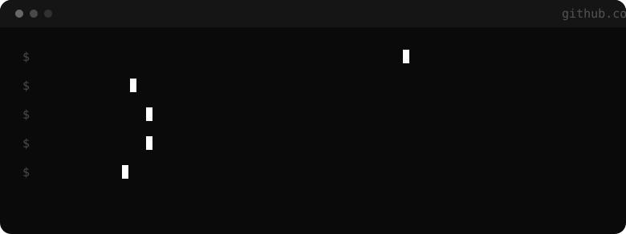
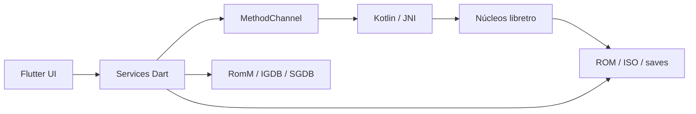

<h1 align="center">loopgamer <sub>v2.7.0</sub></h1>

<p align="center">Emulação retrô no Android</p>

<p align="center">
  
  
  
  
  
</p>

<p align="center"></p>

## Sobre

Emulador retrô para Android em Flutter + Kotlin/C++ (JNI). Roda núcleos libretro (PSP, PS1, PS3 via RPCS3, GBA, SNES, N64 e outros) com Vulkan/Turnip, save states, fast-forward e catálogo RomM/IGDB.

## Recursos

- **Libretro**: núcleos baixados e carregados em runtime, com opções gráficas por jogo (OpenGL ES, software, Vulkan), screen scale, frame duplication e vsync.
- **PS3**: ISOs e dumps de pasta (`PS3_GAME/USRDIR/EBOOT.BIN`), com validação de EBOOT descriptografado e orientação para ManaGunZ/multiMAN/IRISMAN em dumps criptografados.
- **Save states**: 6 slots estilo PPSSPP com preview PNG e metadados. A chave de namespace é estável por `igdbId`, então dumps de pasta que resolvem para `EBOOT.BIN` não colidem entre si.
- **Auto-save**: ao sair ou ao ir para segundo plano, com debounce de 5 s e bloqueio quando o core encerra com falha.
- **Biblioteca**: importação de ROM/ISO com ID determinístico (FNV-1a), manifesto atômico e entradas preservadas quando o caminho externo está temporariamente ausente.
- **Capa e metadados**: IGDB/SteamGridDB/RomM, cache atômico, MD5 do RomM preservado como MD5 (não truncado para CRC32).

## Quick start

**Instalar dependências**

```sh
flutter pub get
```

**Análise estática**

```sh
flutter analyze
```

**Testes**

```sh
flutter test
```

**APK release (arm64)**

```sh
./build-apk.sh
```

<p align="center"></p>

## Estrutura

```text
loopgamer/
├── lib/
│   ├── main.dart                     entrypoint, importação de ROM e top bar
│   ├── screens/                      player libretro, catálogo, biblioteca, settings
│   ├── services/
│   │   ├── emulator_service.dart     sessão, save slots e channel MethodChannel
│   │   ├── rom_download_service.dart download paralelo, mirrors, validação de ISO/PS3
│   │   ├── library_storage_service.dart manifesto atômico da biblioteca
│   │   ├── igdb_steamgriddb_service.dart metadados e capas
│   │   └── cover_cache_service.dart cache atômico de imagem
│   ├── models/                       EmulationGame e settings
│   └── theme/                        tokens PS5/Hydra
├── android/app/src/main/
│   ├── kotlin/.../MainActivity.kt    bridge JNI, sessão libretro, save/load state
│   └── cpp/                          runtime nativo, libadrenotools, glue libretro
├── test/                             121 testes (widget, regressão, PS3, storage)
├── docs/                             AGENTS.md e notas de arquitetura
├── build-apk.sh                      build arm64 com Gradle 8.7 + NDK 27
└── pubspec.yaml
```

## Toolchain

Flutter **3.35.7** / Dart **3.9.2** em `~/.local/share/loopgamer-toolchain/flutter35/flutter`, JDK 17 e Android SDK com NDK **27.0.12077973** no mesmo root.

O Flutter 3.50 não é suportado: `IconData` virou `final class` e quebra `phosphor_flutter` 2.1.0. `build-apk.sh` prefere o SDK pinado quando presente. Gradle 8.7 não lê bytecode de Java 25: em máquinas com JDK mais novo, defina `org.gradle.java.home` no `~/.gradle/gradle.properties` local (fora do repo) apontando para o JDK 17.

O APK release é gerado em `loopgamer-release.apk` (arm64-v8a).

## Rede e arquitetura



O app não expõe rotas HTTP: a comunicação externa é de download e metadados. O player renderiza via `Texture` compartilhada pelo lado nativo; eventos de fatal/shutdown do core bloqueiam auto-save e encerram a sessão.

## Verificação

```sh
flutter analyze   # No issues found!
flutter test      # 121/121
./build-apk.sh    # loopgamer-release.apk
```

---
<sub>readkit.project/v1 · MIT · fraudar · <a href="https://github.com/fraudar/loopgamer">repo</a></sub>
