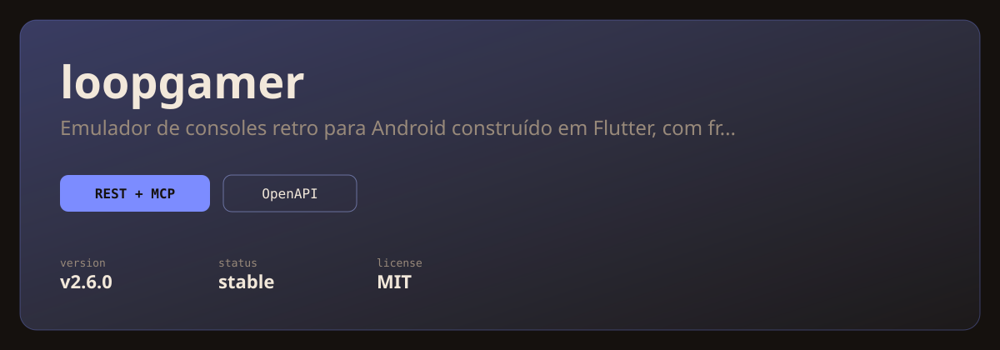
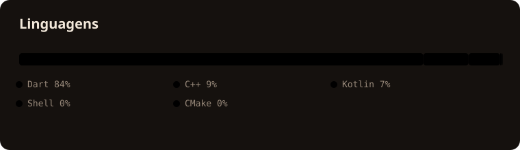
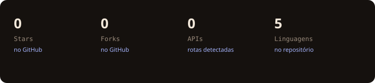

<h1 align="center">loopgamer <sub>v2.6.0</sub></h1>

<p align="center">Emulador de consoles retro para Android construído em Flutter, com frontend</p>

<p align="center">
  
  
  
  
  
</p>

<p align="center"></p>

## About

Emulador de consoles retro para Android construído em Flutter, com frontend

## Estrutura

Arquivos relevantes identificados na varredura. Use esta visão para localizar entrypoints, configuração, rotas e documentação.

```text
loopgamer/
├── pubspec.yaml
├── .github/workflows/build-apk.yml
├── .gitignore
├── .metadata
├── DESIGN.md
├── PRODUCT.md
├── README.md
├── UI-REDESIGN.md
├── analysis_options.yaml
├── android/.gitignore
├── android/app/build.gradle
└── android/app/proguard-rules.pro
```



## Languages



| Language | Share |
|:--|--:|
| Dart | 83.9% |
| C++ | 9.4% |
| Kotlin | 6.5% |
| Shell | 0.1% |
| CMake | 0.1% |

## Metrics



| Metric | Value | Note |
|:--|:--|:--|
| Stars | **0** | no GitHub |
| Forks | **0** | no GitHub |
| APIs | **0** | rotas detectadas |
| Linguagens | **5** | no repositório |

## Stack

`Dart`
